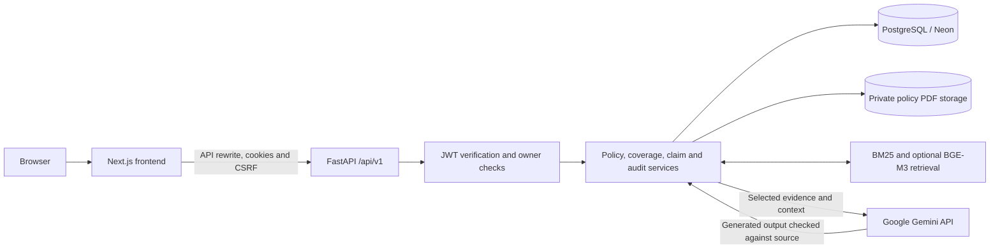

# ClaimWise: AI-Powered Insurance Assistant

ClaimWise helps people understand insurance policies and prepare claims using the wording in their own documents. It combines policy PDF extraction, clause-level evidence retrieval, AI-assisted explanations, and deterministic insurance calculations.

The application supports policyholders, brokers, and advocates reviewing policy terms, coverage questions, and claim preparation. Its guiding principle is **evidence first: if supporting policy evidence is unavailable, the answer should say so**.

ClaimWise is a project demonstration and development application. Coverage explanations, cost simulations, claim drafts, and appeal drafts do not represent an insurer's decision. Sandbox submissions stay within the application; no claims are transmitted to real insurers.

## Key features

| Feature | Implemented behavior | Application page |
| --- | --- | --- |
| Policy library | Upload PDF policies, extract text and clauses with page references, inspect policy sections, and view original PDFs | `/policies` |
| Ask ClaimWise | Ask questions against selected policy evidence; inspect cited clauses, quotes, and page numbers in a conversational interface | `/workspace` |
| Coverage analysis | Describe an incident, review supported findings and uncertainties, and retain analyses with follow-up questions | `/coverage` |
| Policy comparison | Select two to four policies for AI-assisted overlap review with verified source citations and side-by-side results | `/compare` |
| Claim preparation | Save incident details, maintain checklists, attach supporting documents, generate guidance, and prepare claim descriptions | `/claims`, `/claims/new` |
| Bill and appeal workflows | API support for digital medical-bill parsing, illustrative adjudication, EOB/PDF generation, reviewed appeal drafts, and simulated payer responses | Claims API and associated claim views |
| Dashboard | Summarize saved policies and claim preparation, display attention items, and launch a scenario | `/dashboard` |
| Activity & Audit Log | View account-scoped events, filter by action/outcome, paginate, search the loaded events, expand metadata, and request hash-chain verification | `/activity` |
| Accounts and settings | Registration, login, cookie-based session restoration, profile updates, and password changes | `/login`, `/signup`, `/settings` |

The public homepage is at `/`. API-backed features require the relevant configured services and an authenticated account. Features exposed by the API do not necessarily have a separate top-level page.

## How it works

1. Sign in and upload a text-readable policy PDF.
2. The backend checks the upload, computes its SHA-256 document hash, and extracts page-linked clauses.
3. Ask a policy question, analyze a scenario, or compare selected policies. Retrieval supplies policy evidence to the relevant service; AI-generated citations are checked against source clauses.
4. Review supporting wording and any missing information before creating a saved claim draft.
5. Add incident details and evidence, inspect guidance, and review generated documents. Where applicable, run an explicitly confirmed local sandbox simulation.
6. Review recorded actions in Activity & Audit Log.

Unknown terms remain unknown; a missing clause or an empty overlap result does not establish that coverage is excluded or that policies never overlap.

## Technology stack

Versions below come from the repository manifests, not a claim about the latest upstream releases.

| Layer | Technologies |
| --- | --- |
| Frontend | Next.js `16.4.0` App Router, React `19.3.0`, TypeScript 5, Tailwind CSS 4 |
| UI | Motion, Lucide icons, repository-native SVG/CSS illustrations |
| API | Python, FastAPI, Uvicorn, Pydantic 2, pydantic-settings |
| Persistence | PostgreSQL/Neon, psycopg, psycopg-pool, asyncpg; schema includes pgvector support |
| Documents and retrieval | PyMuPDF, rank-bm25, NumPy; optional BGE-M3 dense embeddings |
| AI | Google Gemini through backend HTTP requests using HTTPX |
| Verification | pytest, pytest-asyncio, Node's test runner, TypeScript, ESLint |

Frontend dependencies are locked in [frontend/package-lock.json](frontend/package-lock.json). Backend dependencies use version ranges in [backend/requirements.txt](backend/requirements.txt). Optional embedding packages and model weights are not included in the standard backend requirements.

## Architecture

The browser communicates with Next.js. Browser API calls use the same-origin `/api/v1` rewrite to FastAPI, preserving the cookie/CSRF request flow. FastAPI validates authentication and record ownership before invoking document, retrieval, coverage, claim, comparison, or audit services.

PostgreSQL stores structured policy and claim records, claim attachments, workflow state, and audit events. Original uploaded policy PDFs are stored separately on the backend filesystem. Gemini receives selected evidence and relevant request context for AI-assisted operations.



See the [architecture reference](docs/architecture/ARCHITECTURE.md). The running backend's `/docs` and `/api/v1/openapi.json` describe its current API; older milestone documents may differ from the implementation.

## Repository structure

```text
ClaimWise/
├── README.md                       Main project entry point
├── package.json                    Root development/check command wrappers
├── frontend/
│   ├── src/app/                    Pages, layouts, and styles
│   ├── src/components/             Shared UI and feature components
│   ├── src/context/                Authentication and scenario state
│   ├── src/lib/                    API client and workflow helpers
│   ├── src/types/                  Frontend API contracts
│   ├── scripts/                    Service launchers and Python discovery
│   └── tests/                      Unit tests and manual browser checks
├── backend/
│   ├── app/api/                    FastAPI router and endpoints
│   ├── app/core/                   Settings, authentication, logging, errors
│   ├── app/db/                     Connections, repositories, stores, migrations
│   ├── app/models/                 Domain models
│   ├── app/schemas/                Request and response schemas
│   ├── app/services/               Document, insurance, AI, retrieval, audit logic
│   ├── app/benchmarks/             Benchmark datasets
│   ├── data/policy_pdfs/           Local original-PDF storage, created at runtime
│   ├── scripts/                    Benchmark CLI
│   └── tests/                      Unit, workflow, security, integration tests
├── docs/                           Architecture, API, development, security reports
└── test_pdfs/                      Fictional demonstration fixtures and generator
```

Runtime data, local environments, and generated dependency/build directories are excluded from version control where configured. The [documentation index](docs/README.md) links supporting reports.

## Prerequisites

| Requirement | Project-specific detail |
| --- | --- |
| Node.js and npm | Next.js declares Node.js `>=20.9.0`. Local verification used Node.js `22.17.1`; use a runtime supporting `--experimental-strip-types` for the configured unit tests |
| Python and virtual environments | No project-level Python version is pinned. Local verification used Python `3.14.6`; dependency compatibility on other versions requires validation |
| PostgreSQL | Required for accounts and persisted workflows. Current schema initialization requires pgvector and attempts `uuid-ossp`; provision the appropriate extension/table permissions |
| Gemini API access | Required for live AI-assisted features, including overlap comparison; the API key stays on the backend |
| Optional embedding runtime | BGE-M3 requires additional packages and model resources; retrieval can report a degraded lexical-only mode when unavailable |

The application can start without a working database, but liveness does not establish that sign-in, persistence, or AI features are available. No disposable PostgreSQL instance is bundled.

## Installation and setup

Run commands from the directory containing this README. Reuse an appropriate existing virtual environment where available. Template-copy commands below preserve existing environment files.

### Windows PowerShell

```powershell
if (-not (Test-Path backend/venv)) { python -m venv backend/venv }
./backend/venv/Scripts/python.exe -m pip install -r backend/requirements.txt
npm --prefix frontend ci

if (-not (Test-Path backend/.env)) { Copy-Item backend/.env.example backend/.env }
if (-not (Test-Path frontend/.env.local)) { Copy-Item frontend/.env.example frontend/.env.local }
```

### macOS/Linux shell equivalent

```bash
[ -d backend/venv ] || python3 -m venv backend/venv
./backend/venv/bin/python -m pip install -r backend/requirements.txt
npm --prefix frontend ci

[ -e backend/.env ] || cp backend/.env.example backend/.env
[ -e frontend/.env.local ] || cp frontend/.env.example frontend/.env.local
```

These commands match the repository layout and manifests. Installation on macOS/Linux has not been independently verified in this Windows workspace.

Configure a development PostgreSQL database and your own backend secrets before using persisted features. The store initializes tables/extensions lazily; it does **not** automatically apply every file in `backend/app/db/migrations/`. Review existing migration and schema assumptions before applying SQL.

## Environment variables

Templates: [backend/.env.example](backend/.env.example) and [frontend/.env.example](frontend/.env.example). Placeholder values must be replaced privately; never commit actual environment files or include their contents in reports.

The npm launchers run FastAPI from `backend/`, so its settings load **`backend/.env`**. Next.js loads **`frontend/.env.local`**. An existing root `.env` is not automatically merged into either process. Exported process variables can override file-based values; restart the relevant service after changes.

| Variable | Location and purpose | Example/default |
| --- | --- | --- |
| `DATABASE_URL` | Backend PostgreSQL connection URL, required for saved records and accounts | Configure privately; production requires `sslmode=require` or stronger |
| `JWT_SECRET` | Backend HS256 signing secret | Generate a unique random value; production rejects missing, short, or known weak defaults |
| `JWT_ISSUER` | Backend token issuer; keep stable across signing/verifying workers | `claimwise` |
| `JWT_AUDIENCE` | Backend expected token audience | `authenticated` |
| `ENVIRONMENT` | Backend runtime mode | `development`, `test`, or `production` |
| `DEBUG` | Backend debug setting | Set `false` for production |
| `CORS_ORIGINS` | Backend allowed browser origins | `["http://localhost:3000","http://127.0.0.1:3000"]` for development; explicit HTTPS origins in production |
| `GEMINI_API_KEY` | Backend-only provider key | Use your own key through private environment/secret configuration |
| `GEMINI_MODEL_NAME` | Initial model requested by the backend; service fallbacks also exist | `gemini-3.1-flash-lite` |
| `API_V1_PREFIX` | Backend API prefix; the frontend rewrite path is hard-coded to `/api/v1` and does not follow this setting | Keep `/api/v1` for the supplied client |
| `MAX_UPLOAD_SIZE_BYTES` | Backend upload limit | `26214400` (25 MiB) |
| `CLAIMWISE_BACKEND_URL` | Server-side Next.js rewrite target; takes precedence over the public URL setting | `http://127.0.0.1:8000` locally |
| `NEXT_PUBLIC_API_URL` | Fallback rewrite/server-side API target; browser requests use their current origin | `http://127.0.0.1:8000` locally |

The example files retain legacy Supabase fields. They are not required for the current built-in PostgreSQL/JWT login flow. Never place database credentials, a JWT signing secret, Gemini keys, or a Supabase service-role key in `NEXT_PUBLIC_*` variables.

Production settings additionally require debug mode off, nonempty issuer/audience, valid PostgreSQL credentials with TLS, and explicit HTTPS CORS origins. Passing configuration validation does not prove the database is reachable or the deployment is secure.

## Running the application

Root commands delegate to the frontend package scripts.

| Command | Behavior |
| --- | --- |
| `npm run dev` | Start FastAPI and Next.js; reuse a backend already answering the expected health endpoint, otherwise wait for its startup |
| `npm run backend` | Run FastAPI only, with development reload |
| `npm run frontend` | Run Next.js only in development mode |
| `npm run build` | Build the frontend |
| `npm run start` | Serve the built frontend; start the API separately |

```powershell
npm run dev
```

- Application: <http://localhost:3000>
- API liveness: <http://127.0.0.1:8000/api/v1/health>
- API readiness details: <http://127.0.0.1:8000/api/v1/ready>
- Interactive API documentation: <http://127.0.0.1:8000/docs>

Readiness may return HTTP 200 with partial/unavailable subsystems; inspect the response body. The launcher's health check is a process-liveness check.

For direct backend execution, run from `backend/`:

```powershell
./venv/Scripts/python.exe -m uvicorn app.main:app --host 127.0.0.1 --port 8000 --reload
```

On macOS/Linux, use `./venv/bin/python` instead. The npm launchers explicitly bind the backend to `127.0.0.1:8000`; changing settings named `HOST` or `PORT` alone does not change those launcher arguments.

For deployment, run Uvicorn separately without `--reload`, configure an HTTPS edge and the Next.js rewrite target, and provide durable storage and private secrets. See [deployment notes](docs/deployment/README.md) and the [current security audit](docs/security/PRODUCTION_AUDIT_2026-10-16.md). This checkout contains no verified hosting, container, or CI deployment.

## Testing and quality checks

Run frontend checks from the repository root:

```powershell
npm run typecheck
npm run lint
npm run test:frontend
npm run build
```

Backend integration tests can write and clear persisted fixtures. **Never run them against the application's working database.** The test harness requires `TEST_DATABASE_URL` and `CLAIMWISE_TEST_DB_CONFIRM` for a disposable PostgreSQL test database. It validates the `claimwise_test_` database and role names, an explicit database marker, pgvector availability, and that the database is distinct from configured application databases before routing test connections to it. Do not set these variables to working application credentials. No disposable database is bundled with this checkout.

From `backend/`:

```powershell
./venv/Scripts/python.exe -m pytest tests -q --tb=short -p no:cacheprovider
```

Use `./venv/bin/python` on macOS/Linux. Without a verified disposable database, run only independent tests with `./venv/Scripts/python.exe -m pytest tests -m "not database" -q --tb=short -p no:cacheprovider`; the database guard also blocks unmarked tests that attempt database access. For isolated/offline checks, the [development guide](docs/development/SETUP.md) documents process-local placeholder credentials. Set test AI credentials deliberately to avoid unintended paid requests.

### Recorded verification status

The [security audit dated 2026-10-16](docs/security/PRODUCTION_AUDIT_2026-10-16.md) records the following results. They are historical results from that audit snapshot, not newly executed checks for this README update.

| Check | Recorded result |
| --- | --- |
| Complete backend suite, external services disabled | **273 passed, 54 failed, 17 errors**; full backend verification remains incomplete |
| Focused security/business/upload regressions | **158 passed, 2 deselected**; upload persistence cases were excluded here and failed in the complete run |
| New direct security cases | **92 cases**, included in the passing focused run |
| Frontend TypeScript | Passed |
| Frontend unit tests | **18 passed** |
| Frontend production build | Passed |
| Frontend lint at audit snapshot | **1 error, 14 warnings**, including a React effect error on the Activity page |

A successful subset or frontend build does not establish that all workflows pass. The remaining integration failures include database-backed tests, sample-policy hydration, and legacy fixtures/access assumptions.

Current working-tree checks on 2026-10-16 are separate from the historical audit snapshot above:

| Check | Current result |
| --- | --- |
| Isolated backend security tests (`backend/tests/test_production_security.py`) | **93 passed**; in-memory persistence/provider boundaries, no PostgreSQL integration |
| Backend non-database suite (`pytest tests -m "not database"`) | **285 passed, 1 failed, 42 deselected**; `test_qa_benchmark_api_endpoint` expected 100% decision accuracy but observed 37.5% after a preceding benchmark test |
| Frontend lint (`npm run lint`) | **0 errors, 14 warnings**; the Activity page has no errors and retains unused-import/state-setter warnings |
| Frontend TypeScript (`npm run typecheck`) | Passed |
| Frontend unit tests (`npm test`) | **18 passed** |

The benchmark API test passes in isolation but fails after the preceding benchmark test: the service retains its hydrated flag while the autouse test fixture clears the retrieval indexes, so the following run has no retrieved sample-policy evidence. This order-dependent test-state issue remains unresolved. These checks do not replace the incomplete PostgreSQL integration suite or establish production security. No full integration test was run against an application database.

Manual browser scripts in [frontend/tests/browser](frontend/tests/browser) require a running application and a separately configured Chrome debugging session; some create records. Read them before use. Benchmark scripts can overwrite preserved reports; use alternate output paths when generating new evidence.

## Security and privacy

Implemented controls include signed HS256 JWT verification, HttpOnly authentication cookies, production Secure flags, SameSite=Lax, cookie-authenticated CSRF checks, explicit Origin validation, and authenticated record-ownership checks. New passwords use salted PBKDF2-HMAC-SHA256 with 600,000 iterations; valid legacy hashes upgrade at login. Production demo identities and demo login are blocked.

Uploads have size/type/signature checks; policy PDF filesystem paths require SHA-256 identifiers. Logging and audit metadata include credential/PII redaction controls. These controls do not guarantee complete de-identification or malware detection.

Audit events are stored in PostgreSQL with canonical-payload SHA-256 hashes, sequential links, and a verification routine. This is a **database-backed hash chain**, not a blockchain or externally notarized ledger. Users see owner-scoped event listings; chain verification checks the stored ledger and requires a functioning database.

Selected policy excerpts and incident/conversation context may be sent to Gemini. Use fictional data for demonstrations and review provider/data-handling requirements before using sensitive documents. Logout clears browser cookies; it does not revoke a copied JWT before expiry.

The application is not represented as production-secure, independently certified, or compliant with HIPAA, SOC 2, or another regulatory standard. See the [audit findings and administrator checklist](docs/security/PRODUCTION_AUDIT_2026-10-16.md) for the distinction between tested code controls and unverified deployment controls.

## Sandbox and demonstration workflow

1. Configure a dedicated demonstration database and sign in. Development mode offers fictional demo personas; they still need functioning persistence for account/audit operations.
2. Upload the fictional Policy A and Policy B PDFs from [test_pdfs](test_pdfs), or use another clearly fictional text-readable policy.
3. Ask a question with an explicit policy scope and inspect the quoted clauses/pages. Ask an unsupported question to demonstrate uncertainty handling.
4. Compare the policies, inspect side-by-side evidence, and analyze a scenario from the dashboard or Coverage page.
5. Prepare a claim with fictional incident details, checklists, and attachments. The sample medical bill supports the bill/adjudication workflow.
6. Inspect guidance and generated documents; where offered, explicitly confirm a **sandbox** payer simulation. Review appeal drafts before export.
7. Open Activity & Audit Log to inspect recorded actions and request chain verification.

The [fixture README](test_pdfs/README.md) explains deliberate unknowns and conflicting sample evidence. A bill's billed amount is not automatically an allowed amount or proof of patient responsibility. Demonstration outcomes are not insurer approvals or real submissions.

## Known limitations

- Complete PostgreSQL integration verification remains incomplete; no disposable database is bundled.
- The historical frontend lint error is absent in the current working-tree check; 14 lint warnings remain.
- Production HTTPS, proxy/cookie forwarding, secrets, database permissions, rate limits, backups, and restore procedures require deployment verification.
- Original PDFs use local `backend/data/policy_pdfs/` storage. Ephemeral disks and separate replicas need a reviewed durable/shared-storage plan; PostgreSQL backups alone do not preserve those PDFs.
- Permission-tier definitions are not uniformly enforced across routes. Signed tiers and owner checks do not establish a complete entitlement model.
- Immediate JWT revocation, stricter frontend CSP, parser resource isolation, and malware scanning remain hardening tasks.
- Dense embeddings require optional dependencies/model resources. Image-only PDFs can lack extractable text; the bill parser does not simulate unavailable OCR.
- AI output and citation matching do not guarantee correct coverage interpretation. Overlap review reports how many clauses were examined; input limits can prevent a complete review.
- Historical self-assessments and benchmark reports describe specific demonstration conditions. They do not establish current accuracy, compliance, or production readiness.

## Troubleshooting

| Symptom | Checks |
| --- | --- |
| Localhost does not connect | Run `npm run dev` from the root; inspect backend startup errors and confirm ports 3000/8000 are available. Start services separately to isolate the failing process |
| Backend starts but sign-in/policies fail | Inspect the readiness body. Check the privately configured database URL, network access, TLS, role permissions, and extension availability |
| Changes to root `.env` have no effect | Edit the applicable `backend/.env` or `frontend/.env.local`; inspect process-variable overrides without printing secrets, then restart |
| Imports or dependencies are missing | Install into the interpreter used by the launcher. An active virtual environment takes precedence; `backend/venv` is a supported discovery location |
| Session returns 401 | Sign in again. Expired tokens, issuer/key changes, or a removed legacy session can require reauthentication |
| Mutation returns 403 | Check account ownership, allowed Origin, and the CSRF cookie/header pair. Do not disable security checks to bypass the error |
| AI response/comparison unavailable | Check backend key/model configuration and provider access/quota; missing evidence or failed verification can also produce an unavailable result |
| Original PDF unavailable | Check the private storage volume and the owner-authorized PDF route; extracted database text does not recreate a missing original file |
| Port changed but requests still use the old API | Update the Next.js backend rewrite target and direct Uvicorn arguments together, then rebuild/restart as appropriate; npm backend launchers default to port 8000 |

## Development and contribution

Keep changes focused and preserve API contracts, document ownership, existing records, and insurance calculations. Add meaningful regression tests for behavior changes and report actual failed checks as well as passes. Use disposable databases and synthetic evidence for tests; do not commit secrets, uploaded user data, generated dependency directories, or local verification logs.

Frontend contributors should read [frontend/AGENTS.md](frontend/AGENTS.md) and the installed Next.js documentation before changing framework code. Supporting guides: [backend instructions](backend/README.md), [frontend instructions](frontend/README.md), [development workflow](docs/development/SETUP.md), and [claim workflow](docs/development/CLAIM_WORKFLOW.md).

This README is the main onboarding entry point. Update it when commands, configuration, or supported behavior change; retain historical evaluation evidence with its original scope clearly identified.

## License

No standalone project `LICENSE` file is supplied; licensing has not yet been specified in such a file. Earlier project documentation designated the repository proprietary and confidential. This README grants no new distribution license. Third-party dependencies retain their respective licenses.
